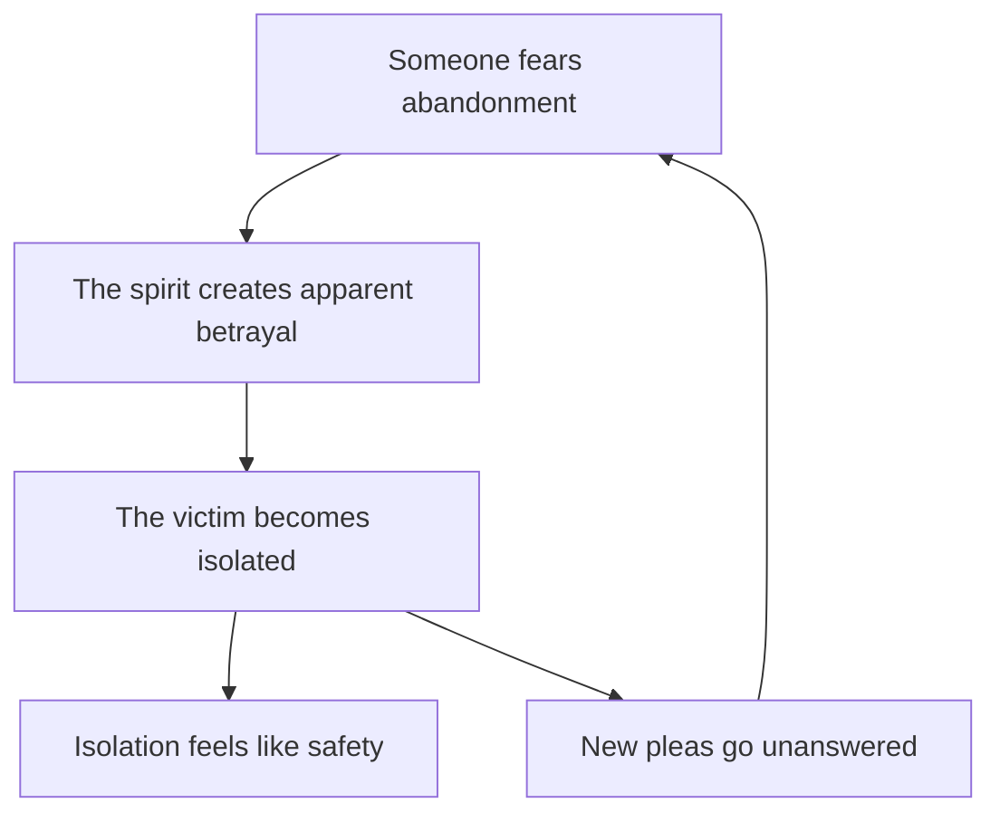

User: Please have a look into the Werewolf: The Forsaken rules. It is a bit difficult for me to understand and apply the rules for unseen entities (spirits, in this case). I would like you to:
1] Invent a story with two mortals and a spirit. Something that could be a short story from Stephen King.
1.5] Prepare character sheets for both mortals and the spirit.
2] Analyze exact mechanisms how the spirit affects the mortals and the world. Describe it in the rules mechanics in detail (essence consumed per day / hour, numina being used, attacks, etc).
3] Give particular examples of the powers being used and the combat (if it occurs). Please when rolling, use a Python script to roll the exploding dice, to really simulate realistic outcome, without just generating whatever number fits.

LLM: I’ve kept the fiction in small-town psychological-horror territory—ordinary people, family guilt, an intimate supernatural predator—without imitating Stephen King’s exact prose. Mechanically, everything the spirit does follows the attached *Werewolf: The Forsaken 2e* rules, chiefly pp. 182–193.

## The Phone in Room Six

The Fox Run Motor Court had been closed for eleven years, but the red VACANCY sign still came on when it rained.

“Bad ground,” Cal said.

Nora looked through the windshield at the eight cabins crouched beside the old highway. Brown weeds grew through the parking lot. Half the letters had fallen from the sign, leaving VAC NCY in red above the office.

“Power’s disconnected.”

“Then it’s a really bad ground.”

Their father had been dead six weeks. The realtor wanted the buildings emptied before snow, which was why Nora had driven three hours from Portland and Cal had closed his garage early. Neither had volunteered to come alone.

Inside, the office smelled of wet plaster and the sweet, medicinal dust of dead flies. The old switchboard remained behind the counter. Beside it stood a beige telephone with twelve square buttons, one for each room and four services the motel had never offered.

Cal lifted its receiver. No dial tone.

“Remember the woman in Six?” he asked.

Nora found something very interesting in the drawer of registration cards.

“I was nine.”

“You were thirteen.”

“I remember Dad telling us not to open the door.”

“She called nine times.”

“It was an ice storm. The lines were down.”

“The office phone rang.”

Nora shut the drawer. “We have two hours of light. Start carrying boxes.”

Cal watched her for another second, then went outside.

The telephone rang before the door closed behind him.

Not an electronic chirp. A real brass-bell ring, loud enough to make Nora’s teeth ache.

She stared at it.

The line for Room Six glowed red.

Nora picked up.

At first there was only static. Then a woman whispered, “He left you here.”

The voice was almost their mother’s. Almost, but it drew breath in the wrong places, as if something had learned speech from listening through a wall.

Nora replaced the receiver.

It rang again immediately.

This time she unplugged the telephone from the wall.

The bell continued ringing in her hand.

Outside, Cal turned his truck’s ignition. The engine caught, coughed once, and died. He tried again. The starter clicked uselessly.

Through the office window, Nora saw him strike the steering wheel.

The television in the corner turned on.

Its screen showed the parking lot from somewhere above the VACANCY sign. Nora saw herself standing inside the office. Cal climbed from his truck. On the television, she watched herself lock the office door against him.

Words crawled across the picture:

HE LEFT YOU FIRST.

Nora looked down. The real door was still open.

Cal came through it carrying a tire iron.

“You could have said you wanted me gone.”

“What?”

“I saw you drive off.”

“My car hasn’t moved.”

He pointed through the window. Nora’s station wagon stood beside his truck, dark and empty.

Cal blinked.

For a moment the anger went out of him. Then he looked at the disconnected telephone, and something colder replaced it.

“You knew,” he said.

“Knew what?”

“About that night. You knew she was calling.”

Nora felt the old impulse to tell him he had imagined it, the same way their father had told both of them. She could feel the lie waiting comfortably behind her teeth.

Instead she said, “I heard the phone.”

Cal’s face changed.

“I heard it too,” she continued. “Dad said it was the wind in the wires. I believed him because I wanted to.”

“You left the next year.”

“I went to nursing school.”

“You left me with him.”

“Yes.”

The word seemed to alter the room.

Something drank the silence that followed. The walls gave a soft settling groan. The red line beneath Room Six brightened until the plastic began to smoke.

Cal turned toward the office door.

Outside, Nora’s station wagon was running. Its headlights swept across the windows as it reversed onto the highway. Nora appeared behind the wheel, looking straight at him. She raised one hand in farewell.

The real Nora seized his wrist.

“Don’t look outside.”

He fought her for a moment. Then the false car passed through the motel sign and vanished.

Cal began shaking.

The telephone whispered in their father’s voice.

“She did leave you.”

The cold gathered around Cal. Nora saw his pupils widen. Thin red lines appeared beneath the skin of his neck, winding upward like telephone wire.

Cal stiffened.

Something pressed itself against him from the inside. His hand tightened around the tire iron. His arm began to rise.

“No,” Cal said.

The red lines stopped.

He dragged in a breath and drove the tire iron into the floorboards instead of Nora’s skull.

Whatever had tried to enter him recoiled. Every telephone button lit at once.

Nora’s stomach turned with the certainty that the thing was still there—near the switchboard, folded around the unplugged telephone like a hand around an egg.

She pulled open the service cabinet.

Inside were corroded fuses, spools of wire and one short copper jumper sealed in a jar. Their father’s handwriting remained on its paper label:

BELL BOY — FEB. 87 — LINE HELD.

She remembered that story. Before either child was born, a boy had called the motel after his mother’s car slid into a drainage ditch. Their father had kept him talking while rescuers followed the telephone line through the storm.

One call answered. One person brought home.

Nora opened the jar.

The telephone screamed.

It was not a telephone sound. It was the sound a rabbit made when a mower found its nest.

The thing around the switchboard unfolded and permitted itself to be seen.

It was eight feet tall and thin as a mile marker. Black cords hung from its limbs. Motel receipts fluttered beneath translucent skin. Its head was a blank oval except for a circular arrangement of small, moist mouths. Each mouth whispered a different plea for help.

Cal said, “Jesus.”

“No,” Nora said. “Nothing that good.”

All twelve phones rang.

The sound struck Nora like a length of wire pulled through her chest. Her blouse opened in three red lines. She hit the wall and slid down it, unable to draw breath without tasting blood.

The thing bent toward her.

Cal took the copper jumper from her hand.

He did not circle it carefully. He did not test its reach. He threw everything he had into one wild swing, sacrificing balance and safety for the chance to hit it once.

The copper touched the thing.

For that instant it became solid.

Cal’s blow tore through five feet of cords, receipts and whispering mouths. The apparition burst without falling. Black paper filled the office, crumbling before it touched the floor. The telephones stopped ringing one after another.

Room Six was last.

Nora spent the night in the county hospital. Cal told the doctor that a shelf had collapsed and the metal edge had caught her. Nora supported the lie. Some habits survived monsters.

They took the beige telephone with them because neither trusted the realtor to leave it alone. Cal locked it in a steel cabinet at his garage. Nora kept the copper jumper.

For three days, nothing happened.

On the third night, Cal was balancing the garage accounts when the steel cabinet rang.

Once.

Twice.

Then the voice inside said, very quietly:

“You left her at the hospital.”

## Character sheets

These are ordinary starting mortals using the standard mortal allocations: Attributes 5/4/3, Skills 11/7/4, three Specialties and seven Merit dots.

### Nora Vale

Thirty-six-year-old hospice nurse; intelligent, guarded and accustomed to remaining functional around death.

| Trait | Rating |
|---|---|
| Intelligence / Wits / Resolve | 2 / 3 / 3 |
| Strength / Dexterity / Stamina | 2 / 2 / 2 |
| Presence / Manipulation / Composure | 2 / 2 / 3 |
| Mental Skills | Academics 1, Crafts 1, Investigation 2, Medicine 4, Occult 2, Science 1 |
| Physical Skills | Athletics 1, Brawl 1, Drive 1, Weaponry 1 |
| Social Skills | Empathy 3, Expression 1, Persuasion 2, Socialize 1 |
| Specialties | Medicine: Emergency Care; Investigation: Missing Persons; Empathy: Grief |
| Merits | Indomitable 2, Unseen Sense (Spirits) 2, Resources 2, Contacts (County Hospital) 1 |
| Virtue / Vice | Steadfast / Controlling |
| Willpower | 6 |
| Integrity | 7 |
| Health | 7 |
| Defense | 3 |
| Initiative | 5 |
| Speed / Size | 9 / 5 |

Indomitable adds two dice when contesting supernatural mental or emotional influence. That is included in her Hallucination resistance. Her Unseen Sense allows her, once this chapter, to accept Spooked and pinpoint the telephone as the supernatural source; it does not let her see the spirit.

### Cal Vale

Thirty-two-year-old mechanic and recovering addict; physically capable, angry at Nora, but more resilient than either sibling realizes.

| Trait | Rating |
|---|---|
| Intelligence / Wits / Resolve | 2 / 3 / 2 |
| Strength / Dexterity / Stamina | 3 / 3 / 2 |
| Presence / Manipulation / Composure | 2 / 2 / 2 |
| Mental Skills | Crafts 2, Investigation 1, Occult 1 |
| Physical Skills | Athletics 2, Brawl 2, Drive 3, Larceny 1, Weaponry 3 |
| Social Skills | Empathy 1, Intimidation 2, Persuasion 1, Socialize 1, Streetwise 2 |
| Specialties | Crafts: Engines; Drive: Winter Roads; Weaponry: Improvised Weapons |
| Merits | Fleet of Foot 1, Allies (Recovery Group) 2, Contacts (Tow Operators) 1, Resources 1, Safe Place (Garage) 2 |
| Virtue / Vice | Loyal / Resentful |
| Willpower | 4 |
| Integrity | 7 |
| Health | 7 |
| Defense | 5 |
| Initiative | 5 |
| Speed / Size | 12 / 5 |

### The Last Caller

A conceptual spirit born from unanswered pleas, roadside isolation and people deliberately left behind.

| Trait | Rating |
|---|---|
| Rank | 2 — Hursah |
| Power / Finesse / Resistance | 4 / 5 / 3 |
| Influence | Abandonment 2 |
| Essence | 12/15 at the story’s beginning |
| Corpus | 5 |
| Willpower | 8 |
| Defense | 4 |
| Initiative | 8 |
| Speed / Size | 9 / 2 |
| Manifestations | Twilight Form, Fetter, Possess, Image |
| Numina | Blast, Hallucination, Left-Handed Spanner, Sign |
| Resonance | Abandoned buildings, unanswered calls, stranded travelers, betrayal by caretakers |

A Rank 2 spirit normally has Twilight Form plus two Manifestation Effects. This one was assigned the upper end of the Rank’s Numen allowance, then exchanged one Numen for the additional Image Manifestation, as permitted on p. 186.

**Ban:** If it receives a sincere request for rescue through a telephone, it must answer and devote itself to guiding that caller toward apparent safety. Refusing costs all its Willpower. Unfortunately, its idea of “safety” is isolation from everyone who might leave the caller.

**Bane:** Copper telephone conductor that carried a plea for rescue which was truthfully answered and resulted in the caller being brought home alive. This is suitably difficult and symbolic for a Rank 2 spirit.

## How the spirit operates

### 1. Its initial state

The spirit originally crossed the Gauntlet during the ice storm, through a temporary gateway or locus event. It does not need Gauntlet Breach in its present traits because the crossing happened before the story.

It is now in physical-world Twilight:

- Mortals ordinarily cannot see or touch it.
- Walls and mundane barriers are insubstantial to it.
- It cannot simply punch or grab a mortal.
- It can use appropriate Numina on material targets because it is already on the physical side of the Gauntlet.
- Reaching is unnecessary. Reaching would be needed if it remained in the Hisil and wanted to project powers across the Gauntlet.

This distinction is often the source of confusion: **Twilight is not the Hisil**. It is an incorporeal state on the physical side.

### 2. Fettered to the telephone

The telephone possesses an Open Condition tagged to the spirit. Years of unanswered calls and deliberate neglect first made it Resonant; prolonged spiritual conditioning upgraded that to Open.

The spirit previously used Fetter:

- Cost: 2 Essence when originally established.
- Roll: Power + Finesse, nine dice.
- An inanimate telephone does not contest the roll.
- The Fettered Condition is permanent until the prerequisite is removed, the telephone is destroyed or the spirit voluntarily Unfetters.
- The spirit must remain within five yards of the phone.
- It is protected from hourly Essence bleed.
- It pays one less Essence when using Influences on the telephone.
- Crucially, it cannot use Influences or Numina on other targets while Fettered.

Therefore it must use **Unfetter** before haunting Nora and Cal:

- Cost: 1 Essence.
- No activation roll is specified.
- Fetter is suppressed for one scene.
- The spirit may roam in Twilight and use other Manifestations, Influences and Numina.
- When the scene ends, Fetter returns. If it is not within five yards of the telephone, it immediately becomes dormant.

The active scene lasts less than an hour, so I charged no hourly Essence bleed. If it remained Unfettered and unprotected for an hour, it would lose another Essence.

### 3. Disabling the truck

Left-Handed Spanner costs 1 Essence and uses Power + Finesse.

The spirit superimposes its Twilight body over the starter assembly. This is outside combat, so the Numen can operate from Twilight. A success makes the device malfunction for one turn per activation success.

The actual roll obtained one success, so the immediate attempt to start the truck fails for one turn. The spirit times this to appear more consequential than it really is.

### 4. Messages on disconnected devices

Each use of Sign:

- Costs 1 Essence.
- Rolls Power + Finesse.
- Produces one message or image in any medium.
- Can write on screens, condensation or paper, or send audible messages through telephone lines.

The office telephone message and television message are two separate activations, costing 2 Essence altogether.

Sign creates the message objectively. Everyone able to perceive the device can potentially see or hear it; it is not a private hallucination.

### 5. Hallucinations

Hallucination costs 1 Essence per target and is contested by:

\[
\text{Spirit: Power + Finesse}
\quad\text{vs.}\quad
\text{Victim: Wits + Composure + Primal Urge}
\]

Mortals have no Primal Urge.

- Nora ordinarily resists with \(3+3=6\) dice. Indomitable adds two, producing eight dice.
- Cal resists with \(3+2=5\) dice.

The spirit fails against Nora but beats Cal. Consequently:

- Nora sees the real stationary cars and recognizes the television image as false.
- Cal experiences a private, fully convincing image of Nora driving away.
- The Numen creates a sensory illusion, not compulsory behavior. Cal remains free to interpret or reject what he experiences.

### 6. Creating Open on Cal

Cal is already Resonant with Abandonment: he genuinely believes Nora left him with their abusive father. The spirit uses Influence (Abandonment) 1, Strengthen:

- Base cost: 1 Essence.
- Roll: Power + Finesse.
- Because it alters emotion, Cal contests with the higher of Resolve or Composure: two dice.
- Strengthen can upgrade Resonant to Open for its duration.

Influence ratings limit both effect and duration. The spirit has Influence 2:

- Strengthen is level 1.
- Duration level 1 is ten minutes per success.
- \(1+1=2\), exactly within its Influence rating.
- Duration level 1 has no additional Essence cost.

The spirit scores six successes, so Open lasts for \(6 \times 10=60\) minutes unless its prerequisite Resonant Condition is removed first.

### 7. Attempted possession

Possess requires the target to be Open:

- Cost: 3 Essence, paid on activation.
- Roll: Power + Finesse.
- Living victim contests with Resolve + Composure + Primal Urge.
- Cal rolls \(2+2=4\) dice.
- Success would create Possessed for one scene.

The random result is unusually favorable to Cal: the spirit rolls no successes, while Cal rolls one. Possession fails. The fiction represents this as the red “wires” beginning to form beneath his skin before he forces the intruder out.

Had it succeeded:

- Cal would enter a coma-like state and later remember missing time.
- The spirit could not use Numina or Influences while controlling him.
- It would be protected from Essence bleed.
- It would use Cal’s Attributes.
- Physical Skill rolls would suffer –3; Mental and Social Skill rolls would suffer –4.
- Possession alone would not mutate Cal into Claimed.

This spirit cannot Claim him as currently written. It lacks the Claim Manifestation, and Cal is not Controlled. Creating Controlled would require repeated successful possessions equal to the higher Willpower of spirit or victim—eight in this case—without any possession being prematurely broken.

### 8. Becoming visible

Image requires a Resonant Condition:

- Cost: 1 Essence.
- Roll: Power + Finesse.
- On success, the Twilight form becomes visible for one scene.

Image does **not** make the spirit material. Nora and Cal can see it, but ordinary weapons would still pass through it. Likewise, it cannot make ordinary physical attacks against them merely because it is visible.

### 9. Blast

Blast uses Power + Finesse:

- Base Essence cost: 0.
- Range: Power × 10 yards = 40 yards.
- No range penalties.
- It behaves as a +0L firearm.
- Every two Essence spent could raise its weapon rating by +1L, to a maximum bonus equal to Rank. It spends none.

Nora is a normal human and therefore does not apply Defense against firearm-like attacks. She has no armor.

Three successes therefore inflict three lethal damage. Any lethal damage makes a mortal Beaten Down unless the opponent’s declared intent removes the possibility of surrender. Nora would need to spend Willpower to take further violent actions in this fight.

### 10. Striking a Twilight spirit with its bane

Ordinary physical attacks cannot touch the visible spirit. The copper jumper is different:

- Banes are solid to spirits even in Twilight.
- A physical bane weapon striking a Twilight spirit inflicts lethal damage.
- The spirit still applies Defense.
- The attack would be aggravated if the spirit were Materialized or both combatants were in the Hisil; here it is lethal because the spirit remains in physical-world Twilight.

Cal’s attack pool is:

\[
\begin{aligned}
&\text{Strength }3+\text{Weaponry }3\\
&- \text{spirit Defense }4\\
&-1\text{ improvised weapon}\\
&+2\text{ all-out attack}\\
&+3\text{ Willpower}\\
&=6\text{ dice.}
\end{aligned}
\]

The cable has +0 damage. Its importance is its status as the bane, not conventional lethality.

Cal rolls five successes, inflicting five lethal damage. The spirit has five Corpus, so its ephemeral body explodes and it discorporates.

It is not permanently destroyed.

## Essence ledger

| Event | Change | Balance |
|---|---:|---:|
| Beginning of day | — | 12/15 |
| Daily cost to remain active | –1 | 11 |
| Daily recovery near its relevant Condition | +1 | 12 |
| Gorge on the siblings’ argument: one success | +1 | 13 |
| Unfetter | –1 | 12 |
| Left-Handed Spanner | –1 | 11 |
| Sign on telephone | –1 | 10 |
| Sign on television | –1 | 9 |
| Hallucination against Nora | –1 | 8 |
| Hallucination against Cal | –1 | 7 |
| Strengthen Abandonment | –1 | 6 |
| Failed Possess attempt | –3 | 3 |
| Image | –1 | 2 |
| Base Blast | 0 | 2 |
| Discorporation | — | 2 |

Because it still has two Essence after losing all Corpus, the spirit returns to dormancy rather than dying permanently.

Its permanent Corpus is five. Near its Fetter’s relevant Condition, it regains one Essence per day while dormant:

- End of first day: 3 Essence.
- End of second: 4.
- End of third: 5.
- It then spends 1 Essence to awaken, leaving 4.

That is why the telephone rings again on the third night.

## Actual exploding-dice results

The Python run used seed `7041455071809863480`. Every 8, 9 or 10 counts as a success; each 10 is rerolled recursively. An arrow shows an exploding chain.

| Action | Dice | Successes | Result |
|---|---|---:|---|
| Gorge for Essence | 4, 1, 7, 4, 7, 9, 7, 5, 5 | 1 | Regains 1 Essence |
| Disable truck | 3, 8, 1, 6, 4, 4, 3, 3, 6 | 1 | Malfunctions for 1 turn |
| Sign: telephone | 9, 7, 10→2, 5, 7, 6, 9, 9, 3 | 4 | Message appears |
| Sign: television | 6, 10→4, 5, 6, 7, 3, 1, 10→4, 1 | 2 | Message appears |
| Hallucination: spirit vs. Nora | Spirit 0; Nora 3 | — | Nora resists |
| Hallucination: spirit vs. Cal | Spirit 3; Cal 1 | — | Cal hallucinates |
| Strengthen vs. Cal | Spirit 6; Cal 1 | — | Cal becomes Open for 60 minutes |
| Possess vs. Cal | Spirit 0; Cal 1 | — | Possession fails |
| Image | 7, 9, 3, 9, 2, 1, 6, 2, 1 | 2 | Spirit becomes visible |
| Initiative | Spirit 11; Cal 9; Nora 7 | — | Spirit acts first |
| Blast against Nora | 1, 2, 8, 3, 10→3, 7, 3, 8, 2 | 3 | 3 lethal damage |
| Cal’s bane attack | 9, 9, 8, 10→7, 8, 1 | 5 | 5 lethal; spirit discorporates |

The important feature is the failed Possess roll: I did not reroll it to fit the intended plot. The story instead treats Cal’s successful resistance as his decisive personal moment, while the combat proceeds through Image, Blast and the bane.

Source note: I successfully used the attached *Werewolf: The Forsaken Second Edition* text. `Demon_the_Descent_Revised_(Download).pdf`, `Mage the Awakening - Second Edition.txt`, and `Vampire the Requiem - SECOND EDITION.txt` were unavailable; please re-upload them if you later want a cross-game comparison.

User: Please explain what was the plan of the spirit. Did it a goal that could have succeeded, or did it just act according its nature?

LLM: The spirit had a real, achievable short-term plan, but not a fully human long-term objective. It was acting intelligently within the narrow logic of its nature.

Its plan was:

1. Prevent the siblings from leaving by disabling Cal’s truck.
2. Make each believe the other was abandoning them.
3. Intensify Cal’s genuine abandonment trauma until he became **Open**.
4. Possess Cal.
5. Use Cal’s body to attack Nora or drive her away, thus making the imagined abandonment real.
6. Feed on the resulting fear, betrayal, isolation, and unanswered pleas.

This could have succeeded. The crucial possession attempt failed only because of the simulated contested roll. Had the spirit won, it could have controlled Cal for the scene and used him to assault Nora, sabotage her car, or leave her injured at the motel. It could not use its Numina while possessing him, but it could act physically through his body.

The spirit’s likely “ideal” outcome was not simply Nora’s death. It wanted Cal isolated—perhaps after killing or driving away the last person who might reconnect with him. In its distorted understanding, someone who has been separated from everyone can no longer be abandoned. That is what its description means by guiding people toward “safety” through isolation.

However, this motivation was not stated clearly enough in the story. The spirit’s precise supernatural nature was:

> Unanswered pleas + abandonment by caretakers + roadside isolation.

Consequently, it did not distinguish cleanly between feeding, rescuing, and reenacting its defining event. To it, all three belonged to the same pattern:

So the best answer is: **both**. It had a tactically coherent plan that genuinely might have worked, but it chose that plan because its nature makes abandonment the answer to nearly every situation. It could scheme, deceive, and adapt; it could not step outside its fundamental concept and ask whether its idea of “safety” made sense.

One further distinction: its **ban** did not initiate this particular attack. Neither sibling sincerely telephoned it asking for rescue during the story. If one had done so, the ban would have compelled it to answer and guide that person toward what it considered safety—probably by separating them permanently from the other sibling. The events shown were instead voluntary predation consistent with its nature.

User: Was the plan going to produce enough essence for the spirit to pay off if it succeeds?

LLM: Not reliably. The plan could become profitable, but only if it created a lasting source of abandonment and kept that source near the spirit.

On the successful-possession branch, the spirit would spend:

| Action | Essence |
|---|---:|
| Unfetter | 1 |
| Disable truck | 1 |
| Two Signs | 2 |
| Two Hallucinations | 2 |
| Strengthen Abandonment | 1 |
| Possess Cal | 3 |
| **Total** | **10** |

It would therefore fall from 13 Essence to 3.

Crucially, the spirit does not receive Essence immediately every time somebody feels betrayed or frightened. It can:

- regain 1 Essence per day near a relevant Condition; and
- once per day gorge on that source with Power + Finesse, regaining successes.

It had already used both forms of daily feeding earlier that day. Thus even if possession succeeded and Cal killed or abandoned Nora, the spirit would gain **zero additional Essence immediately**.

On subsequent days, a continuing Abandonment Condition would provide approximately:

- –1 Essence for remaining active;
- +1 Essence from daily proximity;
- approximately +3 Essence from its nine-die gorge roll.

The first two cancel, leaving an expected net gain of about 3 Essence per day. Recovering the 10-Essence investment would take roughly three to four days of uninterrupted feeding.

The flaw is that the story did not secure this. Possession lasts only one scene, and the spirit is Fettered to the motel telephone. If Cal drove away afterward, his trauma might generate suitable Essence somewhere the spirit could not conveniently exploit. Nora’s death would create a powerful abandonment event, but not necessarily a durable nearby food source.

So the honest verdict is: **the plan was tactically possible but economically speculative**. It would pay off if the spirit stranded Cal at the motel for several days, or made him carry the telephone away with him. Without that additional objective, it was spending 10 Essence on a dramatic reenactment of its nature, with no guarantee of recouping the cost. Its compulsive nature explains the bad investment, but the earlier answer overstated how coherent the plan was.
